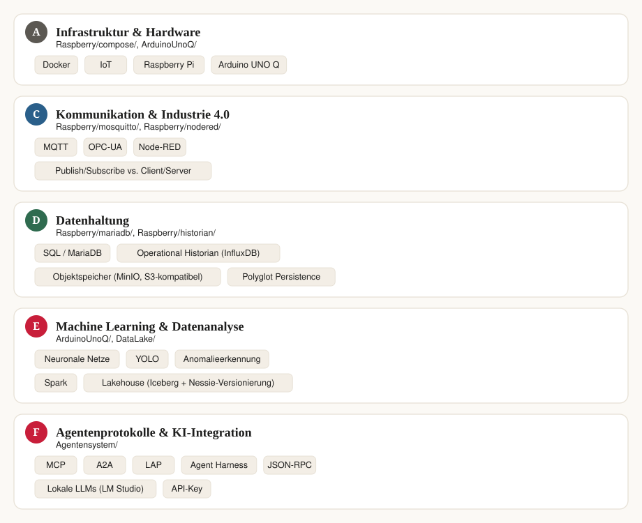
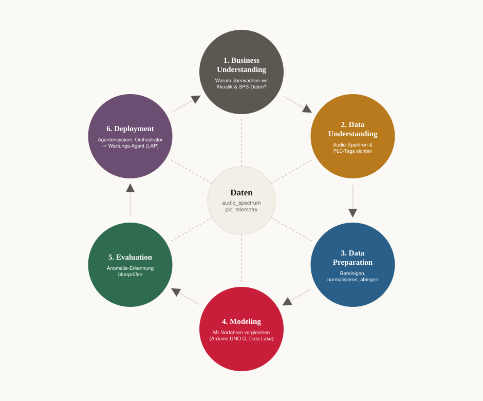
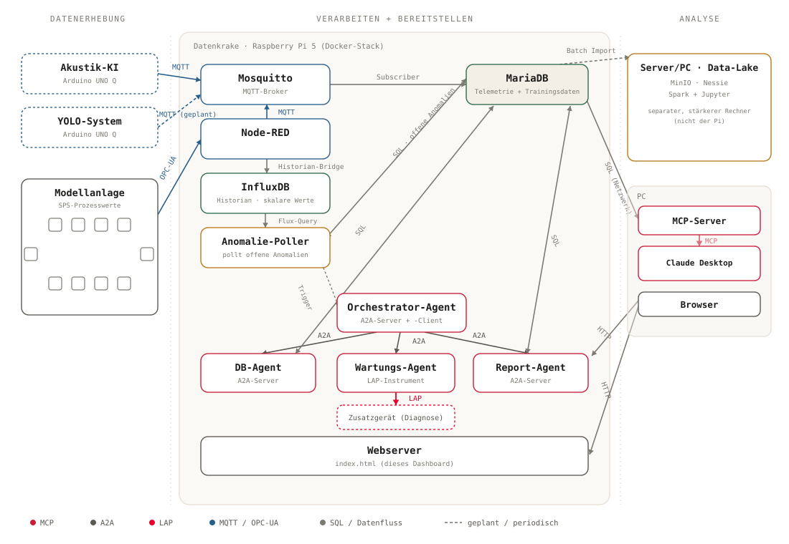

# Übersichtsseite für den Unterricht, mit der die Schüler arbeiten können, findet man unter [https://flowthetensor.github.io/Datenkrake/](https://flowthetensor.github.io/Datenkrake/)

Diese wird auch angezeigt, wenn man datenkrake.local im Browser aufruft, sobald alles auf dem Raspberry läuft.

# Digitaler Zwilling mit Live-Mitschnitt-Demo [https://flowthetensor.github.io/Datenkrake/anlage-zwilling.html](https://flowthetensor.github.io/Datenkrake/anlage-zwilling.html)

Auf GitHub Pages läuft der Zwilling als Demo mit einer aufgezeichneten Produktion. Auf dem Raspberry (`http://datenkrake.local/anlage-zwilling.html`) spielt er die echten Daten aus der Datenbank ab, wahlweise die der Produktion oder die der Stationsteams.

# Datenkrake — Agentensystem (MCP · A2A · LAP)

IoT-Grundstack der Datenkrake sind Audioerfassung, MQTT, MariaDB und
Web-Dashboard und eine industrielle SPS-Anbindung
(OPC-UA/Node-RED), einen Operational Historian, einen Data-Lake-Stack
sowie ein **Agentensystem**, das drei KI-Agentenprotokolle an einer
realen Lernanlage demonstriert:

- **MCP** (Model Context Protocol) — verbindet ein Sprachmodell (Claude
  Desktop) mit Werkzeugen und Daten.
- **A2A** (Agent-to-Agent) — verbindet eigenständige Agenten
  miteinander (Orchestrator delegiert an DB- und Report-Agent).
- **LAP** (Local Agent Protocol) — verbindet einen Agenten mit einem
  physischen Zusatzgerät (Wartungs-Agent), inklusive expliziter
  Sicherheitsbestätigung vor jeder Aktion.

Jeder dieser Agenten ist dabei bereits sein eigener **Harness**: die
Schleife aus LLM-Aufruf, Tool-Ausführung und Gedächtnis, die aus einem
rohen Sprachmodell überhaupt erst etwas macht, das selbstständig
Werkzeuge benutzen kann. Harness ist also keine zusätzliche Komponente
neben MCP/A2A/LAP, sondern eine Eigenschaft der Agenten selbst.

Weiterentwickelt wird die Anlage im Unterricht **agil**: Stationsteams
arbeiten mit Scrum light und einem Kanban-Board in Forgejo, das ebenfalls
auf dem Raspberry läuft (siehe [Agiles Arbeiten](#agiles-arbeiten-scrum-light-und-kanban)).

Die interaktive Dokumentation und der Live-Leitstand liegen in
[`index.html`](Raspberry/web/index.html): Architekturdiagramme, Agenten-Konsole,
Vergleich der ML-Verfahren, OPC-UA-Signaldokumentation der Modellanlage
und ein Quiz zum Gelernten — jeweils mit Verweisen auf die zugehörigen
Ordner im Repo.



*Themen auf einen Blick — hier in fünf Blöcken gebündelt; der Leitstand
(siehe unten) gliedert sie feiner in acht Kapitel A–H, zusätzlich mit
„Agiles Arbeiten“, „CRISP-DM“ und „Datenerhebung“ als eigenen Kapiteln.*

## Zugrunde liegendes Vorgehensmodell: CRISP-DM

Dem gesamten Projekt liegt das **CRISP-DM**-Modell (Cross-Industry
Standard Process for Data Mining) zugrunde. Die Datenkrake ist damit
nicht nur ein IoT-Stack, sondern ein durchgehendes Beispiel für den
klassischen Data-Mining-Kreislauf, angewendet auf echte Akustik- und
SPS-Daten:

1. **Business Understanding** — Warum überwachen wir Akustik- und
   SPS-Daten? Ziel: frühzeitige Anomalieerkennung an der Modellanlage.
2. **Data Understanding** — Audio-Spektren (`audio_spectrum`) und
   PLC-Tags (`plc_telemetry`) über MQTT/OPC-UA sichten.
3. **Data Preparation** — Werte bereinigen, normalisieren und in
   MariaDB bzw. dem Operational Historian ablegen.
4. **Modeling** — ML-Verfahren vergleichen (Arduino UNO Q, Data-Lake-Stack).
5. **Evaluation** — den Anomalie-Detektor gegen reale Messwerte prüfen.
6. **Deployment** — Ergebnis geht ins Agentensystem: der
   Orchestrator-Agent delegiert per LAP an den Wartungs-Agent.



*Die sechs CRISP-DM-Phasen sind ein Kreislauf statt einer Einbahnstraße:
Evaluation und Deployment liefern neue Erkenntnisse, die wieder ins
Business bzw. Data Understanding zurückfließen.*

## Systemvoraussetzungen (Hardware)

| Komponente | Mindestanforderung | Wofür |
| --- | --- | --- |
| **Raspberry Pi** | Modell 4/5, 4 GB RAM oder mehr, Raspberry Pi OS **64-Bit** | zentraler Edge-Server: Docker-Stack mit MQTT, MariaDB, InfluxDB, Node-RED, Forgejo, Web-Dashboard |
| **SD-Karte** | mind. 16 GB (mehr für längeres Logging) | Systemlaufwerk des Pi |
| **SSD (M.2, passend zum Pi)** | empfohlen, z. B. per M.2-HAT/USB3 | InfluxDB schreibt sehr häufig kleine Datenpunkte; auf einer SD-Karte nutzt das die Flash-Zellen spürbar stärker ab und ist langsamer als auf einer SSD. Für Dauerbetrieb daher ratsam, zumindest für `Raspberry/historian/` und die Docker-Volumes |
| **USB-Stick** | ab 16 GB, exFAT, Bezeichnung `DATENKRAKE`; am besten zwei im Wechsel | Datensicherung aller Arbeitsstände, siehe [Datensicherung](#datensicherung) |
| **Internetverbindung** | für den Pi während der Installation | Docker-Installation, Image-Pull |
| **Arduino UNO Q** | mit USB-Mikrofon/Webcam | Audio-Erfassung, FFT, lokale KI-Inferenz (Edge AI); Anschluss nur über PD-fähige Dockingstation, siehe Reihenfolge unten |
| **SPS-Modellanlage** (optional) | z. B. S7-1500/ET200SP mit OPC-UA-Freigabe, 10 Stationen im Anlagen-Netz `192.168.36.0/24` | reale Prozesswerte via OPC-UA → Node-RED. Ohne echte Anlage übernimmt der mitgelieferte `opcua_demo_server` einen simulierten Tag |
| **Windows-/Linux-PC oder Laptop** | mit Claude Desktop | MCP-Client, Anzeige des Leitstands, Bedienung der Agenten-Konsole |
| **Optionaler zweiter Rechner** (Schulserver/Lehrer-PC) | mehrere GB freier RAM | eigenständiger Data-Lake-Stack (MinIO, Nessie, Spark/Jupyter) — bewusst **nicht** auf dem Pi, da deutlich ressourcenhungriger |
| **LM Studio** (optional) | beliebiger Rechner mit genug RAM/VRAM für ein lokales LLM | lokales Sprachmodell für die Agenten (statt Cloud-API) |
| **Netzwerk** | Ethernet zum Anlagen-Netz + optional WLAN als Client in ein bestehendes DMZ-Netz | Pi verbindet Anlagen-Netz und DMZ, ist dabei aber **kein eigener Access Point** |

Beim Anschluss von USB-Mikrofon/Webcam über eine Dockingstation auf
Reihenfolge achten: **zuerst** Dockingstation an Strom, **dann** Webcam an
die Dockingstation, **zuletzt** Arduino UNO Q an die Dockingstation — erst
dann meldet sich die Dockingstation korrekt als USB-Hub/Host an.

## Schnellstart: Klonen, Installieren, Updaten

1. **Raspberry Pi OS (64-Bit) aufspielen** — im Raspberry Pi Imager gleich
   den Rechnernamen **`datenkrake`** eintragen. Leitstand, Forgejo und
   Zwilling verlinken auf `datenkrake.local`.

2. **Repository auf den Raspberry Pi klonen:**

   ```bash
   git clone --branch main https://github.com/FlowTheTensor/Datenkrake.git
   cd Datenkrake
   ```

3. **Erstinstallation** — Setup-Skript im Ordner `Raspberry/` mit Root-Rechten ausführen:

   ```bash
   cd Raspberry
   sudo ./setup_iot_stack.sh
   ```

   Das Skript installiert Docker und Docker Compose (falls nicht
   vorhanden), legt die benötigten Verzeichnisse/Volumes an, baut die
   Container-Images und startet den kompletten Stack. Außerdem richtet es
   den automatischen Start, den Flow-Verlauf von Node-RED und die tägliche
   Datensicherung um 17:00 ein. Beim ersten Mal dauert das einige Minuten.
   Danach die [ersten Schritte nach der Installation](#erste-schritte-nach-der-installation)
   erledigen.

4. **Bestehende Installation aktualisieren** — nach einem `git pull` auf
   dem Pi im selben Ordner:

   ```bash
   sudo ./update_iot_stack.sh
   ```

   Aktualisiert Container-Images, spielt neue (wiederholbare)
   MariaDB-Schema-Änderungen ein und aktualisiert die Node-RED-Eingabeliste,
   ohne bestehende Daten oder aktive Node-RED-Flows zu überschreiben.
   Mit `--sync-nodered-flow` wird zusätzlich die im Repo mitgelieferte
   Flow-Vorlage aktiviert, z. B. um die Stations-Tabs zu bekommen. Der
   bisherige Stand wird vorher gesichert (Backup-Ordner und Flow-Verlauf).

5. **Web-Oberflächen öffnen:**

   | Adresse | Inhalt |
   | --- | --- |
   | `http://datenkrake.local` | Leitstand (`index.html`, siehe unten) |
   | `http://datenkrake.local/anlage-zwilling.html` | Digitaler Zwilling |
   | `http://datenkrake.local/audiodaten.php` | Audio-Live-Dashboard |
   | `http://datenkrake.local/plcdaten.php` | PLC-Telemetrie-Übersicht |
   | `http://datenkrake.local:1880` | Node-RED-Editor |
   | `http://datenkrake.local:3000` | Grafana |
   | `http://datenkrake.local:3001` | Forgejo (Backlog, Kanban-Board) |

   Container-Status lässt sich jederzeit mit `docker compose ps` im Ordner
   `Raspberry/compose` prüfen. Alle Container und Ports:
   [`Raspberry/README.md`](Raspberry/README.md#container-und-ports).

6. **Agentensystem aktivieren** (optional, siehe
   [`Agentensystem/README.md`](Agentensystem/README.md) für Details):
   - `.env` aus `Agentensystem/.env.example` anlegen und anpassen.
   - Python-Umgebung für die Agenten einrichten (`python -m venv .venv && pip install -r requirements.txt`).
   - MCP-Server für Claude Desktop wie in
     [`MCPLokalClaudeDesktop/`](MCPLokalClaudeDesktop) beschrieben konfigurieren.

## Erste Schritte nach der Installation

Einiges erledigt das Setup-Skript bewusst nicht selbst, weil dabei
Entscheidungen oder Passwörter der Lehrkraft gefragt sind:

1. **Ab- und wieder anmelden**, damit der Benutzer Docker ohne `sudo`
   verwenden kann. Hieß der Pi beim Setup nicht `datenkrake`, weist das
   Skript darauf hin; umbenennen mit `sudo hostnamectl set-hostname datenkrake`
   (und den alten Namen in `/etc/hosts` ersetzen).
2. **Prüfen, ob alles läuft:** `docker compose ps` in `Raspberry/compose`
   zeigt alle Dienste als *running*; der Leitstand ist unter
   `http://datenkrake.local` erreichbar. Grafana braucht beim allerersten
   Start etwa eine Minute länger.
3. **SPS-Anbindung prüfen:** Im Node-RED-Editor laufen der produktive Tab
   und je ein Tab pro Station. Ohne echte Anlage antworten die SPSen nicht;
   zum Ausprobieren gibt es den `opcua_demo_server`
   (siehe [`Raspberry/nodered/README.md`](Raspberry/nodered/README.md)).
4. **Forgejo einrichten:** Lehrkraft-Konto, Projekt-Repo mit Labels und
   Issue-Vorlagen sowie die Schülerkonten anlegen:

   ```bash
   cd Raspberry/forgejo
   ./forgejo_einrichten.sh lehrkraft lehrkraft          # eigenes Admin-Konto, Passwort wird abgefragt
   ./forgejo_einrichten.sh projekt lehrkraft            # Repo datenkrake-projekt + Deploy-Verlauf
   cp schueler.beispiel.txt schueler-efs02.txt          # Namen eintragen
   ./forgejo_einrichten.sh schueler schueler-efs02.txt lehrkraft
   ```

   Danach in der Weboberfläche das Kanban-Board und den ersten Sprint
   (Meilenstein) anlegen, siehe [`Raspberry/forgejo/README.md`](Raspberry/forgejo/README.md).
   Die Startpasswörter stehen in `konten-<datum>.csv`: ausdrucken bzw.
   verteilen, dann löschen.
5. **Datensicherung vorbereiten:** USB-Stick als exFAT mit der Bezeichnung
   `DATENKRAKE` formatieren, einstecken und die erste Sicherung von Hand
   anstoßen:

   ```bash
   sudo ./Raspberry/backup/datensicherung.sh
   ```

## Agiles Arbeiten: Scrum light und Kanban

Die Anlage wird im Unterricht von **Stationsteams** weiterentwickelt, der
größte offene Punkt ist dabei die verlässliche Abfrage der OPC-UA-Daten.
Organisiert wird das mit einer schlanken Scrum-Variante für
Unterrichtsblöcke und einem Kanban-Board. Alles läuft auf dem Raspberry im
Schulnetz; das GitHub-Repo wird von den Schülern nicht verändert.

| Baustein | Umsetzung |
| --- | --- |
| **Backlog und Kanban-Board** | Issues und Projekt-Board in **Forgejo** (`http://datenkrake.local:3001`). Spalten Backlog → Bereit → In Arbeit → Test → Erledigt, Labels pro Thema und pro Station, Issue-Vorlagen für User Stories und Fehler. Schüler stellen eigene Issues ein. |
| **Stationsteams** | Je ein Team pro SPS-Station. In Node-RED hat jede Station einen eigenen Tab mit eigener Node-Auswahl (Startpunkt: Bandsensoren und Motor Rechts-/Linkslauf), der nur die eigene SPS abfragt. Die Daten gehen auf `team/<station>/<tag>` und landen getrennt von den Produktionsdaten in der Datenbank. |
| **Arbeitsnachweis** | Jeder Deploy im Node-RED-Editor wird automatisch als Commit gesichert, pro Tab eine eigene Datei mit dem Stationsteam als Autor. Der Verlauf erscheint in Forgejo und lässt sich in Issues verlinken; einzelne Tabs können auf frühere Stände zurückgesetzt werden. |
| **Sprint Review** | Im digitalen Zwilling lassen sich die Daten eines Teams abspielen und mit der Produktion vergleichen, z. B. wie viele Bandsensor-Impulse ein Team gegenüber dem produktiven Abgriff erfasst. |
| **Rollen und Rhythmus** | Product Owner ist die Lehrkraft, Scrum Master wechselt pro Sprint. Sprint von 3–4 Unterrichtsblöcken mit Planning, Stand-up zu Beginn jedes Blocks, Review an der Anlage und Retrospektive. |

Bewährte Lösungen eines Teams übernimmt der Product Owner in den
produktiven Node-RED-Tab. Anleitung, Spielregeln, Definition of Done und
ein Startbacklog stehen in [`Raspberry/forgejo/README.md`](Raspberry/forgejo/README.md);
Stations-Tabs und Flow-Verlauf in [`Raspberry/nodered/README.md`](Raspberry/nodered/README.md).
Im Leitstand ist das Kapitel A „Agiles Arbeiten“, mit eigenen Quizfragen.

## Datensicherung

Alle Arbeitsstände (Messdaten, Forgejo mit Issues und Board, Grafana,
Node-RED-Flows, Flow-Verlauf) werden auf einen USB-Stick mit der
Bezeichnung `DATENKRAKE` gesichert, damit beim Ausfall von SD-Karte oder
Pi nichts verloren geht:

- **nach der Unterrichtsstunde von Hand:**
  `sudo ./Raspberry/backup/datensicherung.sh --auswerfen` (danach kann der Stick abgezogen werden),
- **automatisch täglich um 17:00**, wenn der Stick steckt.

Zurückspielen geht ganz oder für einzelne Teile, auch auf einem neu
aufgesetzten Pi. Anleitung: [`Raspberry/backup/README.md`](Raspberry/backup/README.md).

## Architekturübersicht



Links erheben Akustik-KI und (geplant) YOLO-System per MQTT sowie die
Modellanlage per OPC-UA über Node-RED die Rohdaten. In der Mitte bündelt
die Datenkrake auf dem Raspberry Pi 5 als Docker-Stack Mosquitto,
Node-RED, InfluxDB, MariaDB, den Anomalie-Poller sowie das Agentensystem
(Orchestrator-, DB-, Wartungs- und Report-Agent, verbunden per A2A); der
Wartungs-Agent greift per LAP ausschließlich auf sein eigenes
Diagnosegerät zu, nie auf die Produktionssteuerung. Rechts liest ein
separater, stärkerer Rechner per Batch-Import den Data-Lake-Stack aus der
MariaDB, während ein MCP-Server auf einem PC dieselbe MariaDB abfragt und
die Daten per MCP an Claude Desktop weiterreicht. Dieselbe Grafik lässt sich interaktiv mit
Detail-Overlay in `index.html` unter „Architektur" ansehen.

Für die Projektarbeit im Unterricht läuft zusätzlich **Forgejo** auf dem
Pi (Backlog, Kanban-Board, Deploy-Verlauf der Node-RED-Flows); es ist
nicht Teil der Datenkette.

## Was das Projekt zeigt

Der Leitstand (`index.html`) gliedert das Projekt in acht Kapitel A–H,
die jeweils Erklärung und laufendes System verbinden:

| Kapitel | Inhalt | Zugehörige Ordner |
| --- | --- | --- |
| **A Agiles Arbeiten** | Scrum light und Kanban im Unterricht, Stationsteams, Forgejo als Backlog und Board, Deploy-Verlauf der Flows | `Raspberry/forgejo/`, `Raspberry/nodered/verlauf/` |
| **B Theoretischer Unterbau** | CRISP-DM als Vorgehensmodell des Projekts | — |
| **C Infrastruktur & Hardware** | Docker-Container, Raspberry Pi als Edge-Server, Arduino UNO Q für Edge-AI, Netzwerktopologie (Anlagen-Netz + WLAN-DMZ) | `Raspberry/compose/`, `ArduinoUnoQ/` |
| **D Datenerhebung** | Akustikdaten (Arduino UNO Q), SPS-Tags der Modellanlage (OPC-UA), Zusammenführung über MQTT/Node-RED, digitaler Zwilling | `ArduinoUnoQ/`, `Raspberry/nodered/`, `UAExpertExport/` |
| **E Kommunikation & Industrie 4.0** | MQTT als Publish/Subscribe-Protokoll, OPC-UA als Industriestandard, Node-RED als Übersetzer dazwischen | `Raspberry/mosquitto/`, `Raspberry/nodered/` |
| **F Datenhaltung und -analyse** | MariaDB als vollständige Quelle, InfluxDB als Operational Historian, Grafana und der Data-Lake-Stack (MinIO/Nessie/Spark) für Auswertung | `Raspberry/mariadb/`, `Raspberry/historian/`, `DataLake/` |
| **G Machine Learning** | Vergleich von ML-Verfahren, Anomalie-Detektor aus Akustikdaten, `anomalie_poller` als Brücke zur Agentenkette, vorausschauende Instandhaltung (Isolation Forest, LSTM) zum Selbertrainieren | `ArduinoUnoQ/`, `Agentensystem/anomalie_poller/`, `Agentensystem/ml_training/` |
| **H Agentensysteme & KI-Integration** | MCP, A2A und LAP im Zusammenspiel, live testbar über die Agenten-Konsole im Leitstand | `Agentensystem/`, `MCPLokalClaudeDesktop/` |

Zu jedem Kapitel gibt es zehn Quizfragen.

Für die vollständige Architekturübersicht (alle Komponenten,
Kommunikationsprotokolle und Richtungen) siehe
[`architektur-komponenten.md`](architektur-komponenten.md).

## Projektstruktur

```text
Raspberry/             IoT-Grundstack (Docker Compose): MQTT, MariaDB, Subscriber,
                       Web-Dashboard, Historian, Grafana, Node-RED, OPC-UA-Demo-Server, Forgejo
Raspberry/web/         interaktiver Leitstand, digitaler Zwilling sowie Audio- und PLC-Datenübersichten
Raspberry/nodered/     OPC-UA → MQTT, produktiver Flow und Stations-Tabs; verlauf/ = Deploy-Verlauf
Raspberry/forgejo/     Einrichtung von Forgejo (Konten, Projekt-Repo, Labels, Issue-Vorlagen)
Raspberry/backup/      Datensicherung auf USB-Stick und Wiederherstellung
ArduinoUnoQ/           Audio-Erfassung, FFT, Web-UI, ML-Training/Inferenz auf dem Arduino UNO Q
UAExpertExport/        OPC-UA-Exporte und Dokumentation der 10 Stationen; stationen/ = Node-Auswahl pro Station
Agentensystem/         MCP-Erweiterung, A2A-Agenten (Orchestrator/DB/Report), LAP-Wartungs-Agent
MCPLokalClaudeDesktop/  MCP-Server für Claude Desktop (lesender Zugriff auf die MariaDB)
DataLake/              eigenständiger Data-Lake-Stack (MinIO, Nessie, Spark/Jupyter) für einen separaten Rechner
```

## Weiterführende Dokumentation

- [`Raspberry/README.md`](Raspberry/README.md) — Installation, Update, Container und Ports des IoT-Stacks
- [`Raspberry/forgejo/README.md`](Raspberry/forgejo/README.md) — Agiles Arbeiten: Forgejo, Scrum light, Kanban, Startbacklog
- [`Raspberry/backup/README.md`](Raspberry/backup/README.md) — Datensicherung auf USB-Stick und Wiederherstellung
- [`Raspberry/nodered/README.md`](Raspberry/nodered/README.md) — OPC-UA → Node-RED → MQTT, Stations-Tabs, Flow-Verlauf
- [`Raspberry/opcua_demo_server/README.md`](Raspberry/opcua_demo_server/README.md) — Testen ohne echte SPS
- [`Raspberry/historian/README.md`](Raspberry/historian/README.md) — Operational Historian (InfluxDB)
- [`UAExpertExport/README.md`](UAExpertExport/README.md) — OPC-UA-Signale der Modellanlage
- [`Agentensystem/README.md`](Agentensystem/README.md) — Setup und Umgebungsvariablen des Agentensystems
- [`Agentensystem/ml_training/README.md`](Agentensystem/ml_training/README.md) — Isolation Forest (Akustik) und LSTM (Durchlaufzeit) selbst trainieren
- [`DataLake/README.md`](DataLake/README.md) — Lakehouse-Stack (MinIO/Nessie/Spark)
- [`architektur-komponenten.md`](architektur-komponenten.md) — vollständige Komponenten- und Protokollübersicht
